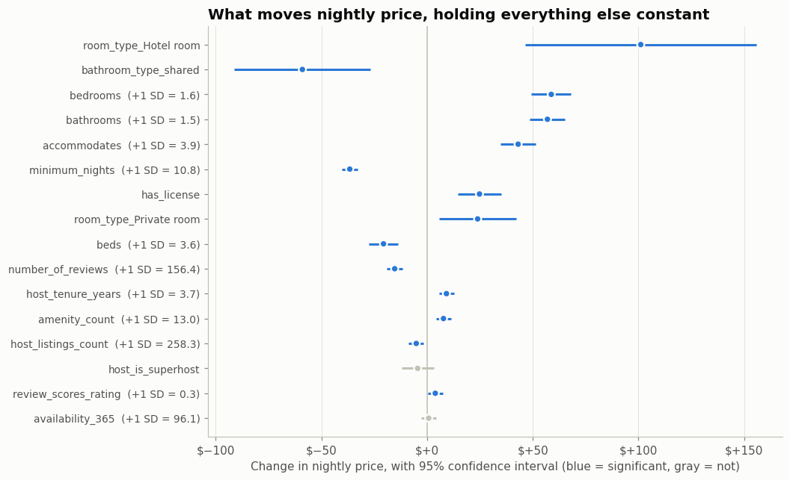
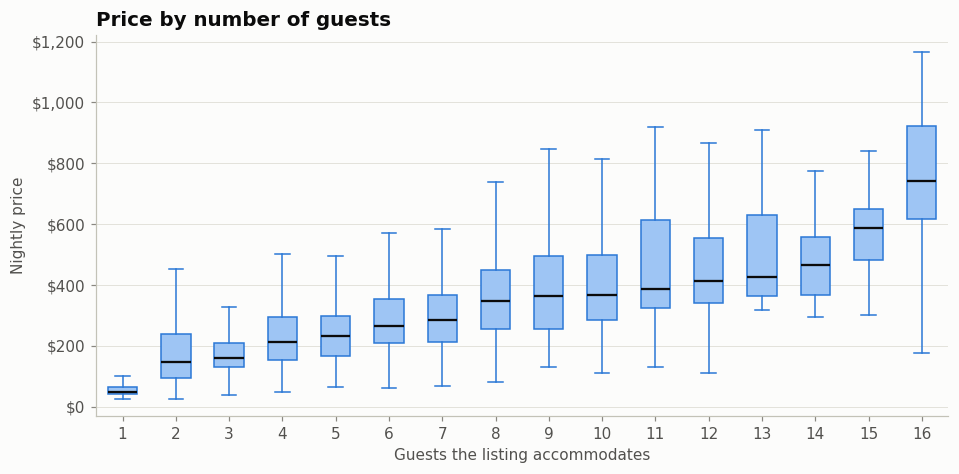

# What Drives Airbnb Prices in Nashville?

This project cleans about 10,000 Nashville Airbnb listings, charts the patterns, and uses linear regression to measure which factors move the nightly price. Everything is in one Jupyter notebook, written in Python with pandas, matplotlib, statsmodels and scikit-learn.

**→ [Open the notebook](Nash_air_bnb_project.ipynb)**



## Key findings

- **Size matters most.** Each bedroom adds about $37 a night, each bathroom about $39, and each extra guest about $11, with everything else held constant.
- **Location matters.** For otherwise identical listings, downtown (Council District 19) costs about $75 more than District 1. Several outer districts cost $70–95 less.
- **What lowers price:** a shared bathroom (about −$59) and a longer minimum stay (about −$3.40 for each extra required night).
- **No measurable effect:** superhost status and the number of days a year the listing is available.
- **Model fit:** the number of guests alone explains about 40% of the variation in price (test R² 0.395). The full model explains about 53% (test R² 0.531), with a typical error of $99 against a median price of $290.



## What the notebook does

1. **Load and inspect** the raw export: 10,133 listings × 90 columns.
2. **Drop columns** that are empty, redundant, URLs, or scrape metadata.
3. **Fix data types:** convert price text to numbers, and `t`/`f` values to true/false. Listings with no price are dropped.
4. **Parse text fields:** turn bathroom text into a count and a shared/private flag, and clean the amenity lists.
5. **Handle invalid values and outliers:** cap placeholder maximum-night values, and flag extreme prices instead of deleting them.
6. **Handle missing values,** with each decision documented.
7. **Engineer features:** host tenure, council district number, price per guest, and stay type.
8. **Validate and export** `clean/listings_clean.csv`.
9. **Chart** price distribution, room type, guests, district, and correlations.
10. **Split** predictors (X) from price (y), with an 80/20 train/test split.
11. **Fit a simple linear regression** of price on the number of guests.
12. **Fit a multiple linear regression** on all predictors, then check coefficients, confidence intervals, VIF, and actual vs. predicted prices.
13. **Summarize the takeaways.**

## Run it yourself

```bash
git clone https://github.com/j3llio/nashville-airbnb-price-analysis.git
cd nashville-airbnb-price-analysis
pip install -r requirements.txt
jupyter notebook Nash_air_bnb_project.ipynb
```

Run all cells. The notebook reads `data/Nashville_listings.csv` and writes `clean/listings_clean.csv`.

## Repository layout

| Path | Contents |
|---|---|
| `Nash_air_bnb_project.ipynb` | The full project: cleaning, charts, and regression models |
| `data/Nashville_listings.csv` | Raw Inside Airbnb listings export for Nashville, scraped September 2026 |
| `clean/listings_clean.csv` | Cleaned table produced by the notebook (9,319 listings × 59 columns) |
| `images/` | Charts used in this README |

## Data source

The listing data comes from [Inside Airbnb](https://insideairbnb.com/get-the-data/), Nashville, Tennessee (scraped 20–21 September 2026). It is licensed under [CC BY 4.0](https://creativecommons.org/licenses/by/4.0/).

## Limitations

- Prices are a single nightly rate captured at scrape time. They are not booked prices and not seasonal averages.
- The size features (guests, bedrooms, beds, bathrooms) overlap heavily, so their individual coefficients should be read with care.
- The model's errors grow at higher prices. Modeling `log(price)` is a natural next step.
